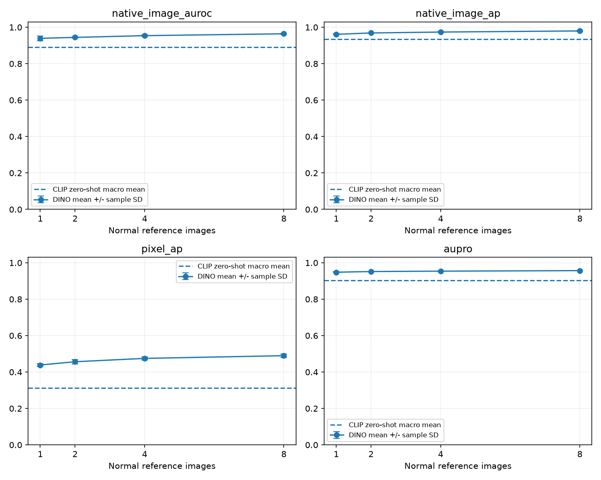
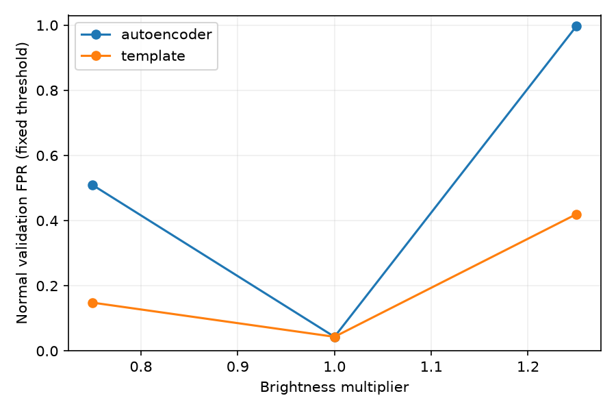

# Few-Shot Industrial Visual Anomaly Detection

AIAA 3201 project: normal-only classical baselines and frozen foundation-model anomaly detection on VisA.

## Handoff status

Part 1 and Part 2 implementations and required six-category experiments are complete. The supplementary course448 brightness comparison and requirement checks are included. Part 3, the final CVPR-format paper, and the final course submission remain pending. This repository is not a claim that the entire course project is finished.

**Start with [PREPARATION.md](PREPARATION.md).** It covers every excluded large asset, pinned upstream repositories, the tested Windows environment, and preparation order. Then follow [Part 1](part1/README.md), [Part 2](part2/README.md), and the [handoff checklist](docs/PART1_PART2_REQUIREMENT_CHECKLIST.md).

The DINO upstream TLS endpoint had an expired-certificate error during handoff checks. PREPARATION includes an exact-hash, safe offline-weight transfer path; do not disable TLS verification.

## What is included

| Directory | Contents |
| --- | --- |
| `part1/` | ECC/mean-template difference and normal-only convolutional AE |
| `part2/` | Official AnomalyDINO/AnomalyCLIP adapters, fixed references and verification |
| `scripts/` | Repository/data/weight preparation, demos and supplementary experiments |
| `results/part1_course448/` | Six-category metrics, histories, 24 classified failures and brightness study |
| `results/part2_course448/` | 78 configurations, mean/SD curves, resource records and visualizations |
| `results/part12_comparison/` | Four-method comparison and fixed example detail crops |
| `docs/` | Interpretation, reproducibility limits, and requirement checklist |
| `assets/` | Pinned source revisions, asset inventories and translation provenance |
| `literature/` | Source links for the recommended papers; not the paper PDFs |
| `part3/` | Explicit placeholder for future improvements and ablations |

Raw images, weights, official clones, dependency environments, checkpoints, feature caches and full heatmaps are excluded. **A Git clone alone does not contain a trained AE or a working model environment.** Rebuild them using PREPARATION and the part-specific commands.

## Shared evaluation contract

The six categories are candle, capsules, cashew, chewinggum, fryum and pipe_fryum. `experiment_protocol.json` fixes RGB bilinear resizing to 448x448 without crop/padding; masks use nearest resizing and `>0`. The official test split is unchanged. Normal training data are split into 2,921 fit and 324 validation images (seed 42); the test set contains 960 images, including 360 normal and 600 anomalous images.

Thresholds use only normal validation data: target image FPR 5%, target pixel FPR 1%, strict `score > threshold`. Report image AUROC/AP/FPR and pixel AUROC/AP/AUPRO separately. AUPRO uses 8-connected regions, 200 thresholds and normalized area up to background FPR 0.30. Test labels must never select operating thresholds.

Part 1 and Part 2 share geometry and evaluation. DINO/CLIP retain their pretrained normalization interfaces. DINO uses shots 1/2/4/8 and seeds 42/43/44. CLIP uses MVTec-trained prompts without VisA gradient training. Native image scores and common heatmap top-1% scores are separate columns; do not mix them.

## Results to inspect

- [Unified comparison](results/part12_comparison/README.md)
- [Part 1 classified failures](results/part1_course448/FAILURE_ANALYSIS.md)
- [Part 2 architecture/output report](part2/REPORT.md)
- [Interpretation and limitations](docs/PART1_PART2_ANALYSIS.md)

## English release and provenance

The active release contains English documentation, comments and user-facing messages. Original Chinese material is retained locally outside this repository's release tree. Historical result hashes remain historical: [source provenance](docs/SOURCE_PROVENANCE.md) explains the explicitly verified English translation mapping. Translating source text does not mean that the old experiments were rerun under the new file hashes.
