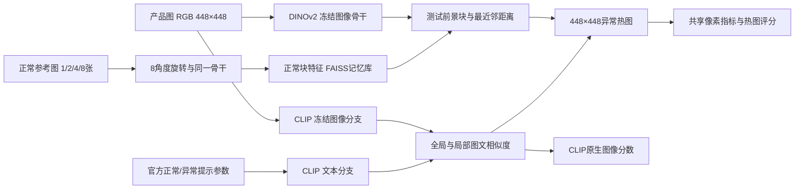

# Part 2：目录、模型架构与结果文件报告

本报告包含目录结构、两个模型的架构、数据流、生成文件和本轮实测结果。正式全量结果已通过78组/16692张热图核验，证据见 results/part2_course448；上传回执另由远程文件比对保存。

## 模型本身的架构

### AnomalyDINO

冻结的DINOv2 ViT-S/14（官方vit_small：12层、每块384维）将448×448 RGB图像分成32×32个14×14块，即1024个块。
每类正常参考图按8个角度旋转，提取正常块特征，构成CPU FAISS IndexFlatL2记忆库。
测试块先由官方PCA策略筛选前景，特征L2归一化后精确找最近正常块，平方L2距离/2对应余弦距离。
距离还原为32×32块图，再用官方dists2map放大至448×448并平滑。无目标类别梯度训练。
参考图来自正常fit，不能来自validation/test。1/2/4/8-shot每个种子使用嵌套的随机前缀。

### AnomalyCLIP

冻结的CLIP ViT-L/14@336px骨干接受统一448输入，按官方代码插值位置编码。
图像分支提取全局图像特征与第24层patch特征；官方DPAM调用参数为20，具体替换范围遵照其源码，不能误写成只替换第20层。
文本分支加载在MVTec训练的提示参数（depth9/n_ctx12/t_n_ctx4，epoch15），编码正常/异常提示。
实际权重结构核对见model_architecture.json：图像Transformer共24层、内部宽度1024，14×14卷积切块后在448输入上得到1024个块；投影到768维共享语义空间。文本Transformer共12层、宽度768，词表49408项，正常/异常文本特征同样是768维。CLIP不是“另一个正常参考图库”：它比较图像特征与两类文本特征。
全局图像与文本相似度给出官方图像异常概率；patch与文本相似度给出局部异常图，sigma4高斯平滑。
不在VisA上训练提示或骨干，属于目标数据零样本比较。

## 项目代码结构

```text
experiment_protocol.json             # 与Part1共享448、划分、阈值和评估约定
part1/common.py                       # 已修复的官方VisA读取、正常划分、图像分数
part1/03_evaluate.py                  # 同一套AUROC/AP/FPR和AUPRO计算
assets/source_revisions.json          # 所用官方仓库URL及固定commit
data/VisA/                           # 原始图像、像素标注、官方1cls.csv划分（不提交）
part2/
  PLAN.md                            # 本轮固定实验方案
  benchmark.py                       # 模型加载、特征缓存、72+6组推理、共享评估
  course_inputs.py                   # 共享RGB/bilinear448、模型接口归一化
  reference_selections.csv            # 270条参考图使用记录，72组随机配置
  verify_results.py                  # 输出、源码、参考图、热图及原生图像分数核验
  check_contract.py                  # 随机参考/划分隔离/相同RGB及归一化逆变换检查
  plot_results.py                    # few-shot曲线、六类四联图
  requirements-deploy.txt            # 独立.deps依赖清单
  faiss-win64-explicit.txt            # 官方conda CPU FAISS锁定包清单
  assets_verified.json               # 官方权重与checkpoint身份核对
  dino_equivalence.json              # 与官方入口匹配样本的数值一致性证据
  clip_equivalence.json              # 与官方入口匹配样本的数值一致性证据
  model_architecture.json            # 直接读取官方权重核对层数与参数形状
  environment_verified.json         # 实测cvproject/Python/PyTorch/CUDA/GPU信息
  export_failures.py                 # 固定原生操作点失败清单与24例四联图
  REPORT.md                          # 本报告
external/                            # 官方源码（不提交仓库，按固定commit准备）
  AnomalyDINO/src/backbones.py        # DINO特征提取与PCA前景策略
  AnomalyDINO/src/utils.py            # 官方旋转增强、距离图插值和平滑
  AnomalyCLIP/AnomalyCLIP_lib/        # CLIP双分支与DPAM实现
  AnomalyCLIP/prompt_ensemble.py      # 提示参数结构
  dinov2/                            # 官方DINOv2网络定义
weights/                             # 官方骨干权重，不提交
```

bootstrap显式读取项目内.deps和官方conda FAISS DLL，保留原cvproject环境。共享几何预处理完全相同；DINO和CLIP各自预训练均值/标准差属于模型接口，显式区分。
`load_eval()`返回已发布Part1评估模块；`evaluate(directory,category)`读取当前组validation/test CSV和热图，只用正常validation校准阈值，再计算指标。
`save_predictions(rows,maps,native,directory)`检查448形状及有限值，逐图保存float32数组，并输出带原生分数和统一热图分数的索引表。
`run_dino(categories,smoke)`从固定清单构建记忆库，缓存冻结特征，再执行检索；`run_clip(categories,smoke)`加载官方提示和骨干，进行图文推理。
这些是项目自定义函数；torch、FAISS、Pillow的调用是库API，不是可任意改名的接口。

## 数据形状与流向



RGB读取结果是uint8 ndarray `[448,448,3]`，三维为高、宽、颜色通道。
网络输入Tensor `[1,3,448,448]` 为批次、通道、高、宽。
DINO特征`[1024,384]`为图片块数、块特征维度。8-shot×8旋转时参考库最多65536行，每行384个float32数；前景只筛测试特征，参考mask关闭，保持官方默认。
最终热图`[448,448]`每个位置是一项连续异常分数。真实掩码用nearest/>0处理，不能用127切掉VisA的低值前景。

## 本地运行结果目录

```text
outputs/course448/part2_final/
  smoke/                             # 每类2正常验证+正常/异常测试各1张，不能作正式结果
  full/
    source.json                      # 实验源码、共享协议、参考清单、评估器SHA256
    cache/dino/<category>/*.npy       # 一次提取的冻结块特征，可重建
    dino/seed_<42|43|44>/shot_<1|2|4|8>/<category>/
      run.json                       # 参考路径、记忆库字节、构建/检索耗时、显存
      metrics.json                   # 当前组统一热图评分与像素指标
      validation/predictions.csv     # 正常验证索引，仅此组用于阈值
      validation/maps/*.npy          # 每张正常验证图的原始浮点热图
      test/predictions.csv           # 完整官方测试索引
      test/maps/*.npy                # 每张测试图的原始浮点热图
    clip/<category>/                 # 同样的run/metrics/validation/test结构，无shot
results/part2_course448/              # 生成后可分享，不含权重、特征缓存和全量热图
  all_runs.csv                       # 78组逐组指标，包含native与common评分
  dino_category_mean_std.csv          # 每类每shot三种子的均值/样本标准差
  dino_macro_mean_std.csv             # 每种子先平均六类，再跨种子统计
  clip_categories.csv                # 六类零样本结果
  run_metadata.json                  # 78组参考/时间/显存/配置记录
  efficiency.csv                     # 标量资源字段，列表配置见上面的JSON
  few_shot_curves.png                # 六类宏平均的三种子均值与样本标准差
  dino_examples.png                  # DINO seed42/1-shot，每类一张异常图四联图
  clip_examples.png                  # CLIP，每类一张异常图四联图
  verification.json                  # 完整性与源码身份验收
  pixel_spotcheck.json                # 两个完整candle组像素指标/阈值重算，范围明确
```

完整正式输出应为72组DINO+6组CLIP，共16692张热图：DINO12次完整六类validation/test预测，CLIP1次。
validation共324张正常图，test共960张。270条参考使用记录包含嵌套复用，不等于270张不同图片。
图像原生评分与统一热图top1%评分分别报告：前者用于官方评分复现曲线，后者是共享聚合对照；不能混着解释。
每类每组阈值均只由正常validation确定，test只在最后计算指标。AUPRO为8邻域、200阈值、FPR上限.30归一化。
缓存命中时不重新提取特征：run.json的累计提取时间和构库/检索时间不能简单加成无缓存速度；显存也应说明是否发生特征提取。

## 环境与运行

配置CVPROJECT_ASSETS指向已经按assets/source_revisions.json准备好external/weights和part2/.deps、.faiss的资产根目录；CVPROJECT_DATA_ROOT指向VisA；CVPROJECT_PART2_OUTPUT指定上述输出根。
使用cvproject的Python执行：

```powershell
python part2/benchmark.py dino --smoke
python part2/benchmark.py clip --smoke
python part2/benchmark.py dino
python part2/benchmark.py clip
python part2/verify_results.py
python part2/plot_results.py
python part2/export_failures.py
```

报告只描述本轮固定配置，不代表论文原生分辨率的原样数字；448是课程共同输入要求下的适配。
Part3仍需在共同协议下做有依据的改进和消融，不能因Part2完成而省略。

## 容易混淆的文件与概念

- Part2没有训练，因此不生成新的模型.pt、training_history.csv或训练loss曲线。weights与官方prompt checkpoint是输入资产，不是本轮训练产物；仓库继承的Part1训练历史也不属于Part2。
- FAISS记忆库不是神经网络权重，只保存正常参考特征；缓存.npy是加速中间产物，CSV/热图/metrics是实验输出，verification.json是核查证据。
- CLIP模型零样本指没有在VisA优化骨干或提示；为了课程OK/NG操作点，仍使用共享正常validation校准阈值，必须与“没有任何目标域数据参与校准”区分。
- DINO原生评分在1024块中取最高10块均值（官方使用floor）；共享评分在448×448图中取最高2008像素均值（ceil），不能把相同比例误当成同一个评分。
- DAPM_replace是官方函数名，DPAM_layer是其参数名（官方源码拼写如此）；其值20不能解释成仅处理第20层。
- 误差图的颜色按每图范围显示，跨图颜色强弱不等于原始分数可比；阈值与指标始终使用原始数值。

## 计时口径

结果目录还导出run_metadata.json和efficiency.csv，汇总78组资源记录。
DINO提取时间是当前进程、当前类别的累计实测值；中断恢复会重置累计计时，缓存命中不计入新提取。不能把恢复后最后一组当成该类别完整冷启动时间，也不能跨组直接累加。构库时间包括参考缓存读取/拼接/归一化/FAISS加库，检索评分包括距离搜索与异常图生成。
PCA前景、模型加载、查询缓存IO、指标计算、绘图不包含在该检索计时中，不能据此推算端到端FPS。
CLIP分别记录GPU特征提取与文图评分/CPU平滑时间，图片读取和输入转换不在GPU特征计时中。
GPU峰值是PyTorch分配量，不是nvidia-smi进程总显存；缓存命中组可能不执行GPU前向，必须与冷提取组区分。
本轮部分DINO与CLIP阶段并行执行，可能存在CPU/GPU资源竞争；表格中的时间是实际运行记录，不是隔离负载下的性能排名。若后续论文要比较端到端延迟，应另做相同负载、明确冷/热缓存、包含IO的独立计时。

## 哪些文件需要保留

| 文件类型 | 用途 | 处理方式 |
| --- | --- | --- |
| 源码、共享协议、固定参考清单 | 定义并复现实验 | 提交GitHub |
| results中的CSV/JSON/PNG | 结果对照、审查和写报告 | 提交GitHub |
| 逐图predictions.csv和maps | 重算阈值、像素指标、定位失败图 | 本地保留，不上传大数组 |
| cache/dino特征 | 减少重复GPU前向 | 可重建；删除后重跑耗时增加 |
| external、weights | 官方模型定义和预训练输入资产 | 本地保留，按官方地址和commit重建 |
| .deps、.faiss | 当前Windows部署依赖 | 不上传，按清单安装 |
| smoke输出 | 快速验证接口是否能跑通 | 独立于full，不用于正式表格 |

失败清单failure_inventory.csv限定DINO seed42/1-shot与CLIP原生操作点，failure_cases_24.csv固定每类每方法两例；图见dino_failures.png和clip_failures.png。
清单按正常图误报、小面积缺陷漏报、较大面积缺陷漏报记录可测现象；面积统计不能证明因果。更深入的原因归纳与受控改进属于后续Part3，不能根据这些测试案例回调本轮阈值。

## 官方来源与课程适配

官方实现：[AnomalyDINO](https://github.com/dammsi/AnomalyDINO)、[AnomalyCLIP](https://github.com/zqhang/AnomalyCLIP)、[DINOv2](https://github.com/facebookresearch/dinov2)。固定源码提交见assets/source_revisions.json；本项目不复制修改其模型实现，而通过本地权重加载、共同输入与共同评估适配课程。
模型冻结和官方权重保持不变；448几何输入、正常validation划分、共享指标与输出格式是本项目适配。原生分数保留用于追踪官方模型行为。

<!-- VERIFIED_RESULTS -->
## 本轮实测结果与验收

正式运行完成72组DINO和6组CLIP；逐图核验共16692张448×448 float32热图。每组完整使用官方test与共同正常validation；参考图严格来自fit。

| 方法 | 图像AUROC（原生） | 图像AP（原生） | pixel AUROC | pixel AP | AUPRO |
| --- | --- | --- | --- | --- | --- |
| DINO 1-shot | 0.9393 ± 0.0138 | 0.9612 ± 0.0033 | 0.9822 ± 0.0010 | 0.4387 ± 0.0071 | 0.9481 ± 0.0037 |
| DINO 2-shot | 0.9444 ± 0.0032 | 0.9687 ± 0.0019 | 0.9841 ± 0.0010 | 0.4566 ± 0.0121 | 0.9519 ± 0.0003 |
| DINO 4-shot | 0.9539 ± 0.0041 | 0.9737 ± 0.0028 | 0.9853 ± 0.0006 | 0.4749 ± 0.0087 | 0.9539 ± 0.0015 |
| DINO 8-shot | 0.9642 ± 0.0039 | 0.9798 ± 0.0026 | 0.9867 ± 0.0002 | 0.4898 ± 0.0100 | 0.9569 ± 0.0010 |
| CLIP zero-shot | 0.8913 | 0.9353 | 0.9649 | 0.3126 | 0.9025 |

DINO每个数先对六类取宏平均，再对三个固定种子计算均值和样本标准差（ddof=1）；CLIP没有随机参考选择，因此不人为重复确定性推理来生成标准差。以下均在0–1尺度。

| CLIP类别 | 图像AUROC（原生） | 图像AP（原生） | pixel AUROC | pixel AP | AUPRO | 原生阈值下test FPR |
| --- | --- | --- | --- | --- | --- | --- |
| candle | 0.8654 | 0.8719 | 0.9890 | 0.3024 | 0.9582 | 0.1000 |
| capsules | 0.8620 | 0.9113 | 0.9532 | 0.2893 | 0.8141 | 0.0500 |
| cashew | 0.7980 | 0.9108 | 0.9308 | 0.1827 | 0.9198 | 0.1200 |
| chewinggum | 0.9680 | 0.9862 | 0.9920 | 0.5677 | 0.8994 | 0.0200 |
| fryum | 0.9358 | 0.9713 | 0.9424 | 0.2212 | 0.8518 | 0.1400 |
| pipe_fryum | 0.9184 | 0.9600 | 0.9822 | 0.3124 | 0.9718 | 0.1800 |

统一热图图像评分的独立对照：

| 方法 | 统一图像AUROC | 统一图像AP | 统一阈值下test FPR |
| --- | --- | --- | --- |
| DINO 1-shot | 0.9440 ± 0.0118 | 0.9676 ± 0.0051 | 0.0750 ± 0.0088 |
| DINO 2-shot | 0.9473 ± 0.0043 | 0.9705 ± 0.0022 | 0.0683 ± 0.0142 |
| DINO 4-shot | 0.9579 ± 0.0052 | 0.9760 ± 0.0031 | 0.0704 ± 0.0128 |
| DINO 8-shot | 0.9665 ± 0.0040 | 0.9812 ± 0.0025 | 0.0800 ± 0.0176 |
| CLIP zero-shot | 0.9026 | 0.9491 | 0.0467 |

阈值使用normal validation的higher分位数且采用严格大于规则，所以正常验证FPR≤5%；测试FPR可以超过5%，不能把验证目标误写成测试保证。shots增加时个别指标不必单调；本轮不据测试成绩更改参考选择、阈值或模型参数。

文件体积（仅正式full目录，不含smoke）：

| 产物 | 文件数 | 实际字节 | GiB |
| --- | --- | --- | --- |
| prediction_maps | 16692 | 13402741248 | 12.482 |
| feature_cache | 1427 | 3819096448 | 3.557 |

DINO参考记忆库为每张参考图8×1024块×384维×4字节；1/2/4/8-shot分别为12/24/48/96 MiB（不含FAISS及Python额外开销）。CLIP没有正常参考记忆库。各组实测时间/显存逐行保存在efficiency.csv；计时边界与恢复缓存限制见前文。

| CLIP类别 | 特征提取秒 | 评分/平滑秒 | 峰值分配GiB |
| --- | --- | --- | --- |
| candle | 81.765 | 1.877 | 1.854 |
| capsules | 60.793 | 1.618 | 1.854 |
| cashew | 60.874 | 1.335 | 1.854 |
| chewinggum | 54.903 | 1.466 | 1.854 |
| fryum | 54.908 | 1.431 | 1.854 |
| pipe_fryum | 55.000 | 1.384 | 1.854 |

固定操作点失败记录：

| 方法 | 完整FP数 | 完整FN数 | 展示案例数 |
| --- | --- | --- | --- |
| dino | 24 | 155 | 12 |
| clip | 36 | 181 | 12 |

这些失败数量仅对应DINO seed42/1-shot与CLIP，不代表所有DINO配置；24例允许同一产品图在两个不同模型下出现，清单保留模型和路径，不能声称24张独立产品图。

验证证据：固定配置/划分/相同RGB检查通过；官方入口匹配样本数值核对通过；78组配置集合、16692张热图形状/类型/有限值/统一分数重算、原生分数图像指标重算与源码SHA256检查通过。共享Part1代码及协议与已发布c679ca1保持一致。正式结果见results/part2_course448/verification.json。

本次正式代码通过独立worktree发布，原学习版脚本未覆盖。输出目录由CVPROJECT_PART2_OUTPUT指定；本轮使用outputs/course448/part2_final/full。GitHub分支为part2complete，克隆该分支后从其仓库根目录运行。


原生图像阈值下的DINO测试FPR（同样先平均六类，再跨三种子）：

| 方法 | native test FPR |
| --- | --- |
| DINO 1-shot | 0.0717 ± 0.0145 |
| DINO 2-shot | 0.0628 ± 0.0175 |
| DINO 4-shot | 0.0550 ± 0.0083 |
| DINO 8-shot | 0.0678 ± 0.0025 |

已检查五张生成总图的可读性和对应关系。可见现象包括正常图也有高响应、微小缺陷漏报、预测区域比标注更宽；这些说明图像级排序、固定阈值决策和像素定位必须分开看，不能从高AUROC直接推断所有缺陷都能在该阈值下检出。
